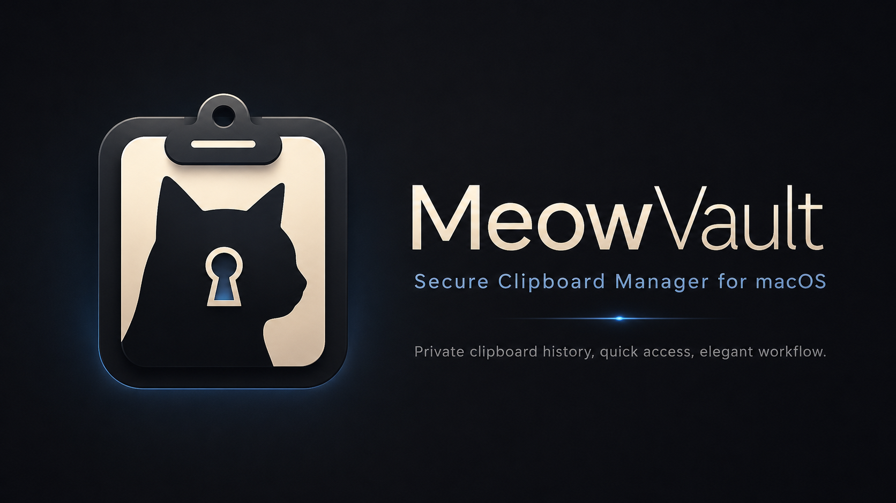

# MeowVault



Fast native macOS clipboard history in the menu bar.

## Features

- Menu bar app with no Dock icon
- Global shortcut: `Cmd+Shift+V`
- Search clipboard history
- Smart groups: links, code, images, emails, text
- Pin important clips
- Duplicate cleanup
- Quick preview
- Copy as plain text
- Text, link, and image clipboard support
- Open-at-login toggle
- Local encrypted clipboard storage
- Optional app password lock
- Light, dark, and system appearance

## Requirements

- macOS 14 or newer
- Xcode command line tools
- Swift 6.2 or newer

## Build

```bash
swift test
swift build -c release --arch x86_64 --arch arm64
```

## Package DMG

```bash
chmod +x scripts/package.sh
./scripts/package.sh
```

Output:

```text
dist/MeowVault.app
dist/MeowVault.dmg
```

## Local Data

MeowVault stores clipboard history locally under:

```text
~/Library/Application Support/MeowVault/
```

The clipboard database is encrypted as `clips.enc`. The local encryption key is generated per user in `storage.key` with `0600` permissions.

The optional app password locks the MeowVault window. It is separate from storage encryption.

## Download

Download the latest DMG from GitHub Releases, or use the packaged DMG included in the repo:

```text
dist/MeowVault.dmg
```

Install by opening the DMG and dragging `MeowVault.app` to Applications.

## Uninstall

```bash
./scripts/uninstall.sh
```

Or manually:

```text
Quit MeowVault
Delete /Applications/MeowVault.app
Delete ~/Library/Application Support/MeowVault
```
